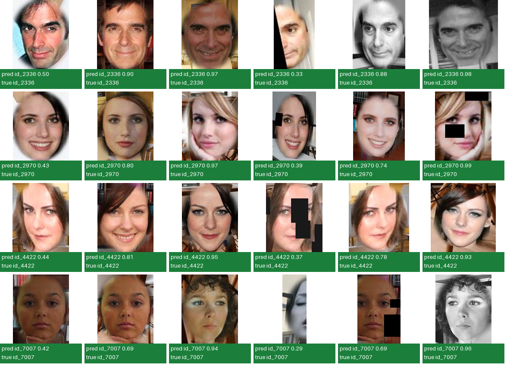
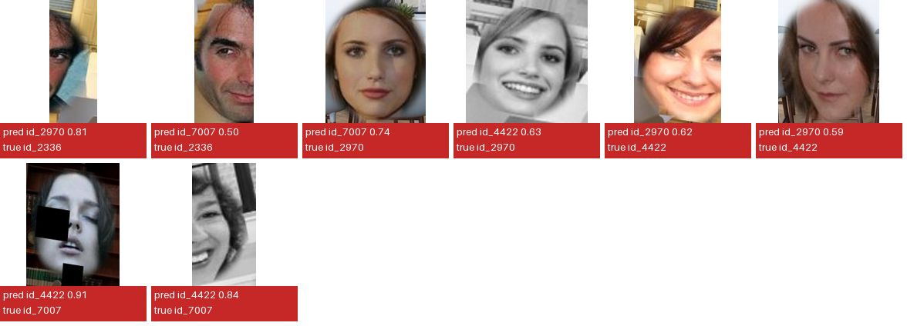
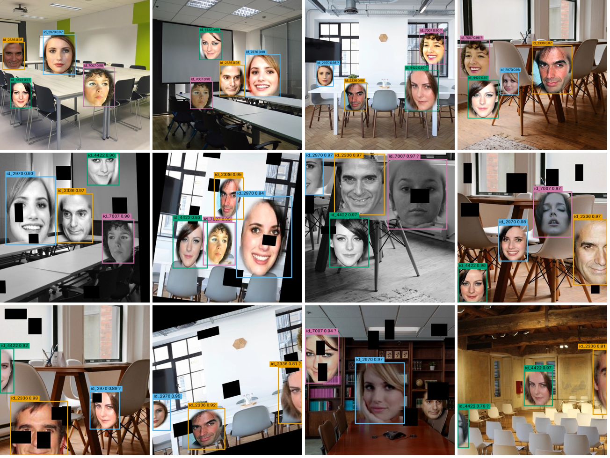

# Final results gallery (Milestone 4)

Held-out **test** split, generated by [`milestone4/Final_Gallery.ipynb`](../../../milestone4/Final_Gallery.ipynb).
Settings: detector confidence 0.7, final name from the detector.
The classifier names 86.4% of the 543 labelled test faces correctly.

## Correctly classified single faces (24)

| file | true | predicted | confidence |
|---|---|---|---|
| [01_test_0044.jpg](correct/01_test_0044.jpg) | id_2336 | id_2336 | 0.5 |
| [02_test_0079.jpg](correct/02_test_0079.jpg) | id_2336 | id_2336 | 0.9 |
| [03_test_0062.jpg](correct/03_test_0062.jpg) | id_2336 | id_2336 | 0.97 |
| [04_test_aug_0050.jpg](correct/04_test_aug_0050.jpg) | id_2336 | id_2336 | 0.33 |
| [05_test_aug_0010.jpg](correct/05_test_aug_0010.jpg) | id_2336 | id_2336 | 0.88 |
| [06_test_aug_0071.jpg](correct/06_test_aug_0071.jpg) | id_2336 | id_2336 | 0.98 |
| [07_test_0049.jpg](correct/07_test_0049.jpg) | id_2970 | id_2970 | 0.43 |
| [08_test_0030.jpg](correct/08_test_0030.jpg) | id_2970 | id_2970 | 0.8 |
| [09_test_0035.jpg](correct/09_test_0035.jpg) | id_2970 | id_2970 | 0.97 |
| [10_test_aug_0087.jpg](correct/10_test_aug_0087.jpg) | id_2970 | id_2970 | 0.39 |
| [11_test_aug_0090.jpg](correct/11_test_aug_0090.jpg) | id_2970 | id_2970 | 0.74 |
| [12_test_aug_0061.jpg](correct/12_test_aug_0061.jpg) | id_2970 | id_2970 | 0.99 |
| [13_test_0092.jpg](correct/13_test_0092.jpg) | id_4422 | id_4422 | 0.44 |
| [14_test_0021.jpg](correct/14_test_0021.jpg) | id_4422 | id_4422 | 0.81 |
| [15_test_0070.jpg](correct/15_test_0070.jpg) | id_4422 | id_4422 | 0.95 |
| [16_test_aug_0064.jpg](correct/16_test_aug_0064.jpg) | id_4422 | id_4422 | 0.37 |
| [17_test_aug_0092.jpg](correct/17_test_aug_0092.jpg) | id_4422 | id_4422 | 0.78 |
| [18_test_aug_0002.jpg](correct/18_test_aug_0002.jpg) | id_4422 | id_4422 | 0.93 |
| [19_test_0088.jpg](correct/19_test_0088.jpg) | id_7007 | id_7007 | 0.42 |
| [20_test_0028.jpg](correct/20_test_0028.jpg) | id_7007 | id_7007 | 0.69 |
| [21_test_0056.jpg](correct/21_test_0056.jpg) | id_7007 | id_7007 | 0.94 |
| [22_test_aug_0015.jpg](correct/22_test_aug_0015.jpg) | id_7007 | id_7007 | 0.29 |
| [23_test_aug_0080.jpg](correct/23_test_aug_0080.jpg) | id_7007 | id_7007 | 0.69 |
| [24_test_aug_0001.jpg](correct/24_test_aug_0001.jpg) | id_7007 | id_7007 | 0.96 |

## Misclassified single faces (8)

| file | true | predicted | confidence | analysis |
|---|---|---|---|---|
| [01_test_aug_0030.jpg](misclassified/01_test_aug_0030.jpg) | id_2336 | id_2970 | 0.81 | Likely cause: cut by the image border. Confident error. |
| [02_test_aug_0040.jpg](misclassified/02_test_aug_0040.jpg) | id_2336 | id_7007 | 0.5 | Likely cause: cut by the image border, small face (110 px). Low confidence (0.50). |
| [03_test_0069.jpg](misclassified/03_test_0069.jpg) | id_2970 | id_7007 | 0.74 | Clear, unaugmented face. Low confidence (0.74). |
| [04_test_aug_0048.jpg](misclassified/04_test_aug_0048.jpg) | id_2970 | id_4422 | 0.63 | Likely cause: grey-scale copy, small face (104 px). id_2970 / id_4422 is the look-alike pair also confused in Milestones 1 and 3. Low confidence (0.63). |
| [05_test_aug_0013.jpg](misclassified/05_test_aug_0013.jpg) | id_4422 | id_2970 | 0.62 | Likely cause: cut by the image border. id_4422 / id_2970 is the look-alike pair also confused in Milestones 1 and 3. Low confidence (0.62). |
| [06_test_aug_0052.jpg](misclassified/06_test_aug_0052.jpg) | id_4422 | id_2970 | 0.59 | Clear, unaugmented face. id_4422 / id_2970 is the look-alike pair also confused in Milestones 1 and 3. Low confidence (0.59). |
| [07_test_aug_0090.jpg](misclassified/07_test_aug_0090.jpg) | id_7007 | id_4422 | 0.91 | Likely cause: partly covered by a dropout hole. id_7007 / id_4422 is the look-alike pair also confused in Milestones 1 and 3. Confident error. |
| [08_test_aug_0082.jpg](misclassified/08_test_aug_0082.jpg) | id_7007 | id_4422 | 0.84 | Likely cause: cut by the image border, grey-scale copy, small face (102 px). id_7007 / id_4422 is the look-alike pair also confused in Milestones 1 and 3. Confident error. |

## Multi-face images (12)

Box colours: id_2336 orange, id_2970 blue, id_4422 green, id_7007 pink. `?` marks a face where the detector and the
classifier give different names.

| file | faces | found_correctly | predicted |
|---|---|---|---|
| [01_test_0001.jpg](multi_face/01_test_0001.jpg) | 4 | 4 | id_2336, id_7007, id_2970, id_4422 |
| [02_test_0010.jpg](multi_face/02_test_0010.jpg) | 4 | 4 | id_2970, id_2336, id_4422, id_7007 |
| [03_test_0012.jpg](multi_face/03_test_0012.jpg) | 4 | 4 | id_2970 (?), id_2336, id_4422 (?), id_7007 (?) |
| [04_test_0019.jpg](multi_face/04_test_0019.jpg) | 4 | 4 | id_7007 (?), id_2970, id_4422, id_2336 |
| [05_test_aug_0010.jpg](multi_face/05_test_aug_0010.jpg) | 4 | 4 | id_7007, id_2336, id_4422, id_2970 |
| [06_test_aug_0044.jpg](multi_face/06_test_aug_0044.jpg) | 4 | 4 | id_7007, id_2336, id_4422, id_2970 |
| [07_test_aug_0051.jpg](multi_face/07_test_aug_0051.jpg) | 4 | 4 | id_2970 (?), id_2336, id_4422, id_7007 (?) |
| [08_test_aug_0068.jpg](multi_face/08_test_aug_0068.jpg) | 4 | 4 | id_2970, id_2336, id_7007, id_4422 |
| [09_test_aug_0077.jpg](multi_face/09_test_aug_0077.jpg) | 3 | 1 | id_2336, id_4422, id_2970 (?) |
| [10_test_aug_0012.jpg](multi_face/10_test_aug_0012.jpg) | 4 | 2 | id_2970, id_2336, id_2336 (?) |
| [11_test_aug_0023.jpg](multi_face/11_test_aug_0023.jpg) | 3 | 1 | id_2970, id_7007 (?) |
| [12_test_aug_0027.jpg](multi_face/12_test_aug_0027.jpg) | 2 | 1 | id_4422, id_2336, id_4422 (?) |
